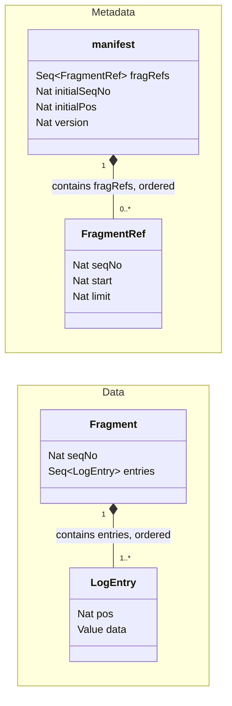
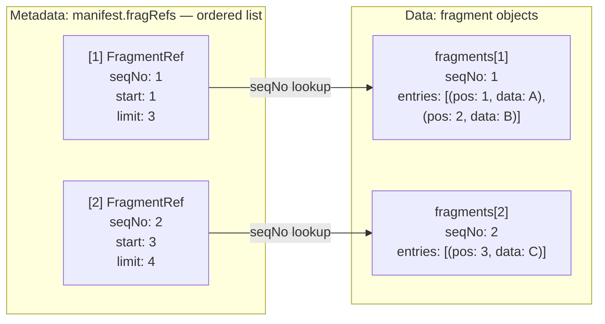
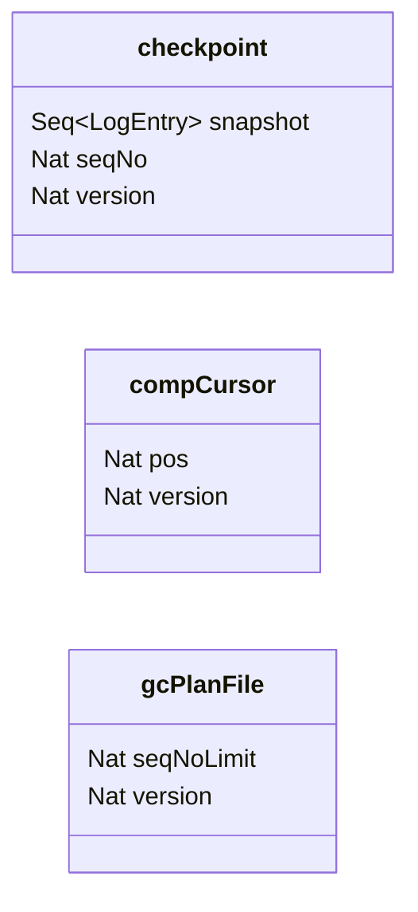

# Chroma's wal3

The [Wal3](Wal3.tla) specification models the S3 implementation of [Chroma's wal3](https://github.com/chroma-core/chroma/tree/main/rust/wal3), together with an abstract compactor that materializes database state.

Materialized state is represented by a single `checkpoint`. The WAL manifest contains a flat list of fragments, omitting wal3's metadata snapshot tree and checksums. Only the compaction cursor is modeled.

The design targets a single active writer, while allowing overlapping writers during replacement. There is no explicit leader epoch or fencing operation: fragment creation and manifest CAS detect competing writes and force refresh or restart.

## Replica model

Each replica runs three independently scheduled roles:

- The WAL **writer** accepts batches, uploads fragments, and publishes them in the manifest. During recovery it can publish a fragment uploaded by another writer.
- The **compactor** replays the WAL into a checkpoint and advances the compaction cursor.
- The **garbage collector** removes checkpointed fragments from the manifest before deleting their objects.

All three share the replica's cached manifest, `rManifest`, which may be stale. Writer and GC actions update this cache. Manifest updates performed by different roles on the same replica are serialized.

Replicas coordinate through S3. There are no follower RPCs or quorum acknowledgments in the model.

## Durable data model

The WAL separates **metadata** from **data**. The checkpoint, compaction cursor, and GC plan are additional durable objects.

### WAL metadata and data

**Metadata:** the manifest contains an ordered list of `FragmentRef` records. **Data:** each fragment object contains an ordered list of `LogEntry` records. The composition diamonds below show these two containment relationships.



`Nat` is a nonnegative integer, `Value` belongs to the model's `Values` set, and `Seq<T>` is an ordered sequence. Reference ranges include `start` and exclude `limit`. Fragment objects are created using put-if-absent.

The link between the two layers is an address lookup: a reference's `seqNo` identifies the separate object at `fragments[seqNo]`. Fragment sequence numbers count files; log positions count entries. For example:



The next fragment would have sequence number 3 and start at position 4.

We can think of fragments being stored in a fragment prefix, in a sequentially numbered address space, where each fragment stores a sequence of log entries with contiguous log positions:

```
/fragments/0000000001 (pos 1-4)
/fragments/0000000002 (pos 5-13)
/fragments/0000000003 (pos 14-21)
```

Append coordinates initially start at one. With nonempty references, the manifest's last reference determines the next coordinates. When GC empties the list, it saves those next coordinates in `initialSeqNo` and `initialPos`, so appending continues beyond the collected prefix.

### Checkpoint, cursor and GC plan

Compaction and GC maintain three further objects, each with its own CAS version:



`checkpoint.snapshot` holds materialized entries through the inclusive fragment `seqNo`. `compCursor.pos` is the inclusive log position published by compaction. `gcPlanFile` represents the `GARBAGE` file: its `seqNoLimit` is an exclusive fragment deletion boundary, with zero denoting an empty plan.

Each conditional write is atomic for one object. There is no transaction spanning a fragment, manifest, checkpoint, cursor, or GC plan. `auxCommitted` records entries published by successful manifest appends; `auxUsedValues` bounds write attempts. Both are specification bookkeeping, not S3 objects.

## Transitions

### WAL Writer initialization/recovery

A WAL writer goes through the 3-step initialization/recovery process when in the `IDLE` state, or `REFRESH` state. A writer enters the `REFRESH` state after certain conflicts with another writer.

The normal path is `IDLE/REFRESH -> PROBE_NEXT -> *COMMIT_RECOVERED -> READY/UPLOAD_FRAGMENT`:

1. `RefreshManifest`: An `IDLE` or `REFRESH` writer loads the durable manifest, stored locally as the "cached manifest". Transitions to `PROBE_NEXT`.
2. `ProbeNextFragment`: A `PROBE_NEXT` writer probes the next fragment address beyond the cached manifest's tail. 
    * If absent, initialization is complete (enters `READY` state). 
    * If a fragment is present it enters `COMMIT_RECOVERED`.
3. Optionally `WalCommitRecoveredFragment`: A `COMMIT_RECOVERED` writer appends the probed fragment's reference to the manifest fragment list and attempts a manifest CAS. Success advances the append coordinates and the initialization is complete. A CAS conflict returns to `REFRESH` to retry initialization.

On initialization completion, the writer enters `READY` state to accept writes unless it has an ongoing write, in which case it transitions to `UPLOAD_FRAGMENT`. 

Recovery therefore may recovery and publish the fragment of another writer. That writer may have crashed or both writers may be competing to publish the unpublished fragment.

```text
 [IDLE] or [REFRESH] or [READY] (cached manifest stale)
                         |
                  RefreshManifest
                         |
                    [PROBE_NEXT]
                         |
                         v
                  ProbeNextFragment
                  /               \
         (address absent)     (fragment found)
                |                    |
                |                    v
                |            [COMMIT_RECOVERED]
                |                    |
                |         CommitRecoveredFragment
                |              /            \
                |       (CAS success)    (CAS conflict)
                |              |               |
                |              |               v
                +--------------+           [REFRESH]
                               |
                               v
                    (initialization complete)
                       /                \
              (no pending batch)    (pending batch)
                      |                   |
                   [READY]        [UPLOAD_FRAGMENT]
```

### WAL Writer appends

The normal path is `READY -> UPLOAD_FRAGMENT -> COMMIT_FRAGMENT -> READY`:

1. `READY, AcceptWrites` accepts a nonempty batch of previously unused values.
2. `UPLOAD_FRAGMENT, UploadFragment` assigns consecutive log positions to each log entry and creates the next fragment using put-if-absent. If the address already exists, it retains the pending batch and returns to `REFRESH` for recovery and retry.
3. `COMMIT_FRAGMENT, CommitFragment` appends the fragment reference using the cached manifest. It attemps a manifest CAS. Success records the entries in `auxCommitted`, clears the batch, and advances the append coordinates. A CAS conflict puts both the replica's writer and GC into `PREEMPTED`.

> PREEMPTED is a state used by this spec to avoid infinite battles for control between writers. Once a writer is established, any manifest write conflict causes the writer to halt.

These are two distinct conflict points during appends: 
1. Fragment upload at a sequential fragment address. A conflict causes the writer to go through refresh/recovery before trying to upload the fragment again at the next address.
2. Manifest CAS, which controls publication in the log. A conflict causes the writer to restart, but in this spec, it halts the the writer.

Upload alone is not a commit in this model, however, once a fragment has been successfully uploaded, it is guaranteed to be committed during the next refresh/recovery cycle (by any writer).

```text
                    [READY]
                       |
                  AcceptWrites
                       |
               [UPLOAD_FRAGMENT]
                       |
                 UploadFragment
                 /            \
       (address exists)      (created)
              |                  |
              v                  v
          [REFRESH]       [COMMIT_FRAGMENT]
              |                  |
      refresh/recovery      CommitFragment
              |              /         \
              |       (CAS success)  (CAS conflict)
              |              |             |
              v              v             v
      [UPLOAD_FRAGMENT]   [READY]     [PREEMPTED]
                                      writer + GC
```

### Compaction

Two durable files exist in S3: the checkpoint and the compaction cursor.

The normal path is `IDLE -> REPLAY_WAL -> COMMIT_CHECKPOINT -> READ_CURSOR -> COMMIT_CURSOR`:

1. `IDLE, CompactorStart` loads the published checkpoint.
2. `REPLAY_WAL, CompactorReplayWAL` reads successive fragments that exist after the checkpoint position and applies them to the local checkpoint state.
3. `COMMIT_CHECKPOINT, CompactorCommitCheckpoint` publishes the checkpoint using CAS write; a conflict ends the run. On success, the compactor continues.
4. `READ_CURSOR, CompactorReadCursor` loads the compaction cursor.
5. `COMMIT_CURSOR, CompactorCommitCursor`  advances the cached cursor to the checkpoint's last log position, then attempts a CAS write of the cursor. End of compaction.

Publishing the checkpoint before advancing the cursor ensures GC only collects data already materialized. Cursor contention can leave the cursor behind the checkpoint, delaying collection.

```text
                    [IDLE]
                       |
                 CompactorStart
                       |
                       v
                 [REPLAY_WAL] <------------------------------+
                       |                                     |
              CompactorReplayWAL                             |
                       |                                     |
                       +-- (fragment found, apply entries) --+
                       |
                       +-- (missing fragment) -------> [IDLE]
                       |
              (no more fragments)
                       |
                       v
              [COMMIT_CHECKPOINT]
                       |
           CompactorCommitCheckpoint
                       |
                       +-- (CAS conflict) -----------------> [IDLE]
                       |
                 (CAS success)
                       |
                       v
                 [READ_CURSOR]
                       |
              CompactorReadCursor
                       |
                       +-- (cursor already caught up) -----> [IDLE]
                       |
                 (cursor behind)
                       |
                       v
                [COMMIT_CURSOR]
                       |
             CompactorCommitCursor
                       |
            (CAS success or conflict)
                       |
                       v
                    [IDLE]
```

### GC

GC works with a plan file which stores the first seqNo to keep, `seqNoLimit`. Fragment deletion is based on this `seqNoLimit` value.

GC separates planning, manifest trimming, and object deletion into three phases:

1. **Phase 1, Plan.** 
    1. Read the compaction cursor.
    2. Read the GC plan file (GARBAGE file).
    3. Take one of the following actions:
        a. `Abort`, see there is nothing to collect, so abort.
        b. `New plan`, see the plan file is empty, so compute a new GC boundary `seqNoLimit` based on the compaction cursor position and persist a new plan file (via CAS) and keep the plan "pinned".
        c. `Reuse plan`, see there is an existing plan that is still applicable. Reuse that plan (no CAS write).
        d. `Reset plan`, see there is an existing plan that is not applicable. Write an empty plan (CAS) and revert to step 2 of phase 1.
2. **Phase 2, Manifest Trim.** 
    1. Reread the current plan from S3.
    2. Check its boundary against the cached manifest. If not applicable anymore, abort.
    3. Remove fragment refs from the list in the manifest below that boundary. CAS write the manifest. A manifest CAS conflict preempts writer and GC.
3. **Phase 3, Delete.** 
    1. Reread the plan from S3 and check that it still matches the pinned version in phase 1. If not matching abort.
    2. Reread the durable manifest in S3 and verify it still has fragments above the pinned plan's boundary (if not, abort). 
    3. Delete fragments objects below the pinned boundary.

```text
           [IDLE] or retryable [ABORTED]
                         |
                 GcPhase1ReadCursor
                         |
                         v
               [GC_P1_READ_GC_FILE]
                         |
                 GcPhase1ReadGcFile
                         |
                         v
               [GC_P1_COMPUTE_PLAN]
                         |
                GcPhase1ComputePlan
                         |
                         +-- (nothing to collect) ----------------> [IDLE]
                         |
                         +-- (inapplicable plan) --> ResetPlan
                         |                              |
                         |                              v
                         |                     [GC_P1_READ_GC_FILE]
                        / \
                       /   \
        (applicable plan) (empty plan)
                     /       \
                    /         \               
                   |           |
                   |           +-- (new-plan CAS conflict) --> [ABORTED]
                   |           |
                   |        (CAS succcess)
                   |           |
                   v           v
               [GC_P2_READ_GC_FILE]
                         |
                 GcPhase2ReadGcFile
                         |
                         +-- (plan no longer applicable) ----> [ABORTED]
                         |
                       (trim)
                         |
                         v
               [GC_P2_CAS_MANIFEST]
                         |
                GcPhase2CasManifest
                         |
                         +-- (CAS conflict) --> [PREEMPTED]
                         |
                   (CAS success)
                         |
                         v
               [GC_P3_READ_GC_FILE]
                         |
                 GcPhase3ReadGcFile
                         |
                         +-- (pinned version changed) --> [ABORTED]
                         |
               (pinned version matches)
                         |
                         v
               [GC_P3_READ_MANIFEST]
                         |
                GcPhase3ReadManifest
                         |
                         +-- (pinned plan not 
                         |    applied to manifest) --> [ABORTED]
                         |
                     (applied)
                         |
                         v
                  [GC_P3_DELETE] <-----------------------------+
                         |                                     |
                         +-- GcPhase3Delete -------------------+
                         |   (delete one object below pinned limit)
                         |
                (none left below limit)
                         |
                 GcPhase3Complete
            (clear plan if version still matches)
                         |
                         v
                      [IDLE]
```

## Invariants

The safety properties are defined in [Wal3Properties.tla](Wal3Properties.tla):

- `TypeOK`: durable objects, replica state, and auxiliary history have the expected types.
- `ValidReplicas`: At least one writer remains unpreempted.
- `ValidFragments`: referenced fragments exist, their bounds match their references, and positions within each fragment are consecutive. Adjacent references with consecutive fragment sequence numbers have adjoining ranges.
- `ConsistentCheckpoint`: the checkpoint is a prefix of committed history; when its fragment sequence number matches the manifest tail, it equals the entire history.
- `ManifestRepresentsCommittedLog`: the checkpoint matches the corresponding committed prefix, and each referenced fragment matches its exact slice of committed history, including fragments already covered by the checkpoint.

[Wal3.cfg](Wal3.cfg) selects `Spec` and these five safety invariants. Checking the liveness properties requires selecting `LivenessSpec` and the desired temporal properties.
